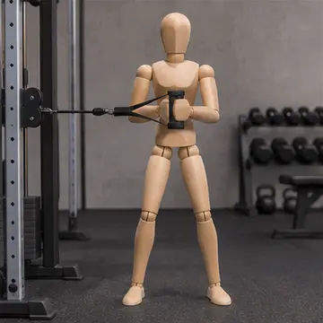

# Gettin' Yoked: install and user guide

Gettin' Yoked is a workout log for the gym. You log every set as you go, and it shows
what you did last time, so you know what to beat. Over the weeks it charts how
your strength is growing.

- **It's free and works offline.** Once it's installed, you don't need a signal at the gym.
- **Your data stays on your phone.** There's no account and no sign-in, and nobody else
  can see your workouts. That also means backups are up to you (see
  [Backups](#backups-import-and-export)).

**App link:** https://chrisd7913.github.io/gettin-yoked/

---

## Contents

- [Install](#install)
  - [iPhone](#iphone)
  - [Android](#android)
  - [Updates](#updates)
- [Use](#use)
  - [The four tabs](#the-four-tabs)
  - [Your first workout](#your-first-workout)
  - [Logging sets](#logging-sets)
  - [Exercise cards: demos, variations and more](#exercise-cards-demos-variations-and-more)
  - [Finishing a workout](#finishing-a-workout)
  - [Routines](#routines)
  - [Blocks](#blocks)
  - [The Library and its filters](#the-library-and-its-filters)
  - [Adding and editing exercises](#adding-and-editing-exercises)
  - [Progress charts](#progress-charts)
  - [History](#history)
  - [Backups, import and export](#backups-import-and-export)
  - [Settings](#settings)
- [Training tips](#training-tips)

---

## Install

Gettin' Yoked is a *web app*: you add it to your home screen from the browser, and from
then on it opens and works like any other app. Nothing comes from an app store.

### iPhone

1. Open **Safari** (it has to be Safari) and go to
   **https://chrisd7913.github.io/gettin-yoked/**.
2. Wait until the app appears, then give it about **30 seconds** more. In that time it
   saves itself onto your phone for offline use.
3. Tap the **Share** button (the square with an arrow pointing up), scroll down, and tap
   **Add to Home Screen**, then **Add**.
4. From now on, open Gettin' Yoked from the orange dumbbell icon on your home screen.

> **Important:** on iPhone, the home-screen app keeps its own data, separate from Safari.
> Always use the home-screen icon, not a Safari tab. And if you delete the icon, **your
> workouts are deleted with it**, so make a backup first.

### Android

1. Open **Chrome** and go to **https://chrisd7913.github.io/gettin-yoked/**.
2. Wait until the app appears, then give it about **30 seconds** more so it can save
   itself for offline use.
3. Tap the **⋮** menu (top right), then **Add to Home screen** (it may say **Install app**),
   then **Install** or **Add**.
4. Open it from the new icon on your home screen or in your app list.

### Updates

There's nothing to do. When there's a new version, the app picks it up the next time you
open it with an internet connection, and it's in use from the launch after that. Your
workouts are never touched by an update.

---

## Use

### The four tabs

| Tab | What it's for |
|---|---|
| **Train** | Start a workout, resume one in progress, or continue a block |
| **History** | Every finished workout, newest first |
| **Blocks** | Training blocks (multi-week plans) and how you're progressing in each |
| **Library** | Your routines (saved workout plans) and every exercise, with demos |

The **gear icon** at the top right opens backups, import/export and settings.

### Your first workout

1. On **Train**, tap **From a routine** and pick one. Two come built in:
   - **Rebuilding Confidence:** six exercises, mostly machines and cables plus a barbell bench press, an easy way in if you're
     new or coming back after a break.
   - **Full Body A:** five barbell lifts, mostly at one power rack.
2. It asks **Count it toward a block?** If you're not sure yet, tap **No block**. You can
   change it later. (A block is covered [below](#blocks).)
3. Log your sets as you go (see the next section), then tap **Finish**.

Your other options on Train:

- **Repeat a past workout** starts with the same exercises as a workout you've done,
  filled in with that workout's numbers.
- **Blank workout** starts empty; add exercises as you go.

Only one workout can be in progress at a time. If you leave the app, the Train tab has a
**Resume** button to get back to it.

### Logging sets

Each exercise card has one row per set:

| Column | What to enter |
|---|---|
| **lb** (or kg) | The weight. For dumbbells, the weight of **one** dumbbell. |
| **Reps** | How many reps you did. |
| **RIR** | *Reps in reserve*: about how many more reps you could have done with good form. 0 = you couldn't do another; 2 = you had two left. |
| ✕ | Deletes that set. |

- **Add set** adds a set with the same numbers as the one above it. Adjust as needed.
- **Grey numbers in empty boxes** are what you did last time, so you can see what to beat.
- **Repeated workouts start filled in.** When you repeat a past workout or tap **Go** on a
  block, every set starts with last time's numbers (a message at the bottom says so). Just
  change whatever's different. If you skip an exercise, **Remove** it or clear its sets,
  or the filled-in numbers will be saved as if you did them.
- Above the sets, **Last (date):** lists your previous sets, and a **goal** tells you what
  to aim for: beat last time by a rep, or *"You hit the top of the range last time. Add
  weight."*
- **Target** (under the exercise name, e.g. *3 × 8–12 @ RIR 2*) is the plan: 3 sets of 8
  to 12 reps, stopping with about 2 reps left.

**Bodyweight exercises** (push-up, pull-up, dip): enter **added** weight, so leave it at 0
or blank for bodyweight. On an *assisted* machine or with a band, enter the help as a
**negative** number (−60 = 60 lb of help). That way, needing less help shows as progress.
**Plank:** enter seconds in the Reps box.

### Exercise cards: demos, variations and more

**The ⓘ button** opens the exercise's sheet:

- an animated **demo** of the movement
- **cues** for good form
- which muscles it works and where in the gym to do it
- buttons for **Progress** and **Edit**

**Variation chips** sit under the exercise name. Many exercises come in versions, such as
Bench Press with Barbell, Dumbbell or Machine, or Lat Pulldown with a straight bar or a
MAG grip handle. Tap a chip to set what you're actually using. Each version is tracked
separately, so your dumbbell numbers aren't compared with your barbell numbers. The demo
changes to match where there's one for that version.

**The ⋮ menu** on each card:

- **Per limb (L/R):** log left and right separately, for one-arm or one-leg work.
- **Fill in last time's numbers:** copies all of last time's sets in.
- **Swap exercise:** replaces it, for example when a machine is taken. The exercise picker
  has the same filters as the Library (see
  [below](#the-library-and-its-filters)).
- **Move up** / **Move down:** reorder, for example to do a free machine first.
- **Remove:** deletes the exercise from this workout.

**The ⋮ menu at the top of the workout** lets you rename it, change its block, change its
date, or delete it. There's also a **Workout notes** box at the bottom.

### Finishing a workout

Tap **Finish**. Sets with nothing entered are removed; a set with anything entered (even
just reps) is kept as you entered it. The workout moves to **History**.

### Routines

A routine is a saved workout plan: a list of exercises, each with a target (sets, rep
range, RIR) and, where it applies, a variation.

- **To make one:** go to **Library → Routines → New routine**. Name it, add exercises, and
  set each one's **Sets**, **Min reps**, **Max reps** and **RIR**.
- **To change one:** tap it. You can reorder or swap exercises, add notes, **Duplicate**
  it as a starting point for a new one, **Archive** it to hide it, or delete it.
- **To find archived routines:** tap the **Show archived** chip.

### Blocks

A block (also called a *mesocycle*) is a stretch of weeks, usually about 8, where you run
the same routine, or a *split* of several routines in rotation (e.g. Upper / Lower), and
push the numbers up. The app keeps count for you, so every workout shows where it falls,
like **Week 3 · Workout #6**.

- **To start a block:** go to **Blocks → New block**. Tap one routine, or several for a
  split; they rotate in the order you tap them (the chips get numbered). Then name it,
  and set the start date and how many weeks you plan to run it. You can run several
  blocks at once.
- **To continue a block:** the **Train** tab lists your active blocks, each showing which
  routine is next. **Go** starts it, filled in with your numbers from the last time you
  did that routine in the block. In a split, the **⋮** next to Go lets you do a different
  routine today instead.
- **The block's page shows:**
  - a chart of **total volume per workout** (weight × reps, all added up), so you can see
    workout-to-workout progress at a glance;
  - **Progress by exercise**, a small chart for each exercise you can tap for full
    details;
  - every workout in the block.
- **When you're done:** open the ⋮ menu and tap **End block**.

### The Library and its filters

**Library → Exercises** lists every exercise, each with a small demo picture.

- **Filter by body part:** tap **Chest, Back, Shoulders, Arms, Core, Hips & glutes** or
  **Legs**.
- **Then by muscle:** a second row appears with that body part's muscles, for example
  Shoulders → **Anterior delts, Medial delts, Posterior delts, Rotator cuff**.
- **Include secondary:** the filter shows exercises where that muscle is a main target.
  Turn this on to also include exercises where it only helps.
- **Search:** in the exercise picker (when adding or swapping), type in the box at the
  top. It searches names, muscles (including common nicknames like "side delts") and
  equipment.

The same filters appear whenever you **add an exercise** to a workout or routine, or
**swap** one.

Tap an exercise to see its demo and cues. Its **⋮** menu has **Edit**, **Progress**,
**Archive**, and **Delete**. An exercise you've already used can only be archived, so
your history stays intact.

### Adding and editing exercises

Tap **New exercise** in the Library or in the exercise picker. You can set:

- **Demo GIFs** at the top: **Add GIF** to choose an image or animated GIF from your phone.
  Each one's ⋮ menu has **Replace GIF**, **Change variation** (which version it shows), and
  **Remove**.
- **Name**, **Station / equipment**, and **Notes / cues**.
- **Primary** and **Secondary muscles:** tap to choose from the list. These drive the
  filters.
- **Per limb by default:** for exercises done one side at a time.
- **Variations:** tap **Add variation type** for ready-made ones (Equipment, Grip, Grip
  width, Angle, Stance) or make your own. This keeps the library tidy: one *Lat Pulldown*
  with grip and handle options instead of ten separate pulldowns.

### Progress charts

Open an exercise's **Progress** from its ⓘ sheet, from its ⋮ menu in the Library, or by
tapping its card on a block's page.

- **Variation chips** at the top switch between the versions you've done.
- **What it can chart:**
  - **Est. 1RM:** your estimated one-rep max, worked out from weight, reps and RIR. This
    is the best overall strength measure.
  - **Top weight:** your heaviest set.
  - **Volume:** weight × reps, all sets added up.
  - **Reps:** total reps.
- **First / Latest / Best / Change** sum it up, followed by the chart and every session.
  Each session shows its change from the previous one, and new records get a **Best
  yet** badge.

### History

Every finished workout, newest first. Tap one to see it: each exercise's sets side by side
with the previous time you did that exercise (and that date), what changed (e.g. *+2 reps*,
*+15 lb*, green when it's better), and your estimated 1RM and volume for each exercise.

To fix a mistake, tap the **pencil** at the top to edit, then **Done**.

### Backups, import and export

Your workouts live only on your phone, so **make a backup now and then**, and always
before deleting the app or switching phones.

- **To back up:** tap the **gear icon**, then **Full backup**. This saves one file with
  everything; keep it somewhere safe, like Google Drive, iCloud Drive or an email to
  yourself.
- **To restore** (or move to a new phone): tap the gear icon, then **Import files**, and
  pick the backup file. Importing only adds or updates; it never deletes anything. A
  workout in progress is never overwritten.
- **Other exports:**
  - **New completed workouts:** just the workouts since your last export, handy for
    sharing your training with a coach.
  - **All completed workouts.**
  - **Exercises and routines:** your library on its own, to share with a friend.

### Settings

**Weight unit** switches between **lb** and **kg**. This only changes the label; numbers
you've already entered aren't converted.

---

## Training tips

- **Start light.** Your first couple of weeks are for learning the movements and
  finishing every set with 2–3 reps left (RIR 2–3).
- **Progress with *double progression*:**
  1. Pick a rep range, say 8–12.
  2. Keep the same weight and add reps each session until every set reaches 12.
  3. Then add the smallest weight step and work back up from 8.
  The app's goal line under each exercise tells you which step you're on.
- **Use RIR honestly.** Going all-out on every set isn't needed for progress, and it makes
  it harder to recover for next time.
- **Run blocks of about 8 weeks:** RIR 3 for weeks 1–2, RIR 2 for weeks 3–6, RIR 1 for
  weeks 7–8. Then take an easy week before starting the next block.
